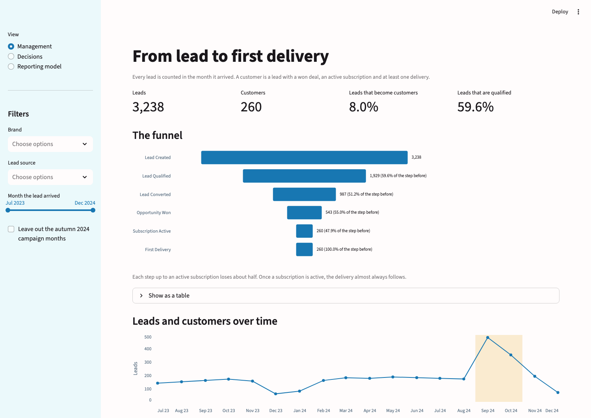
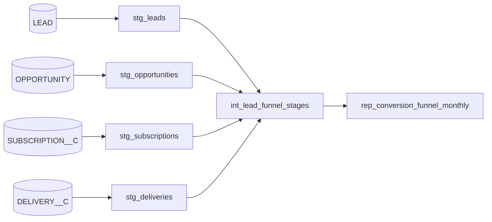
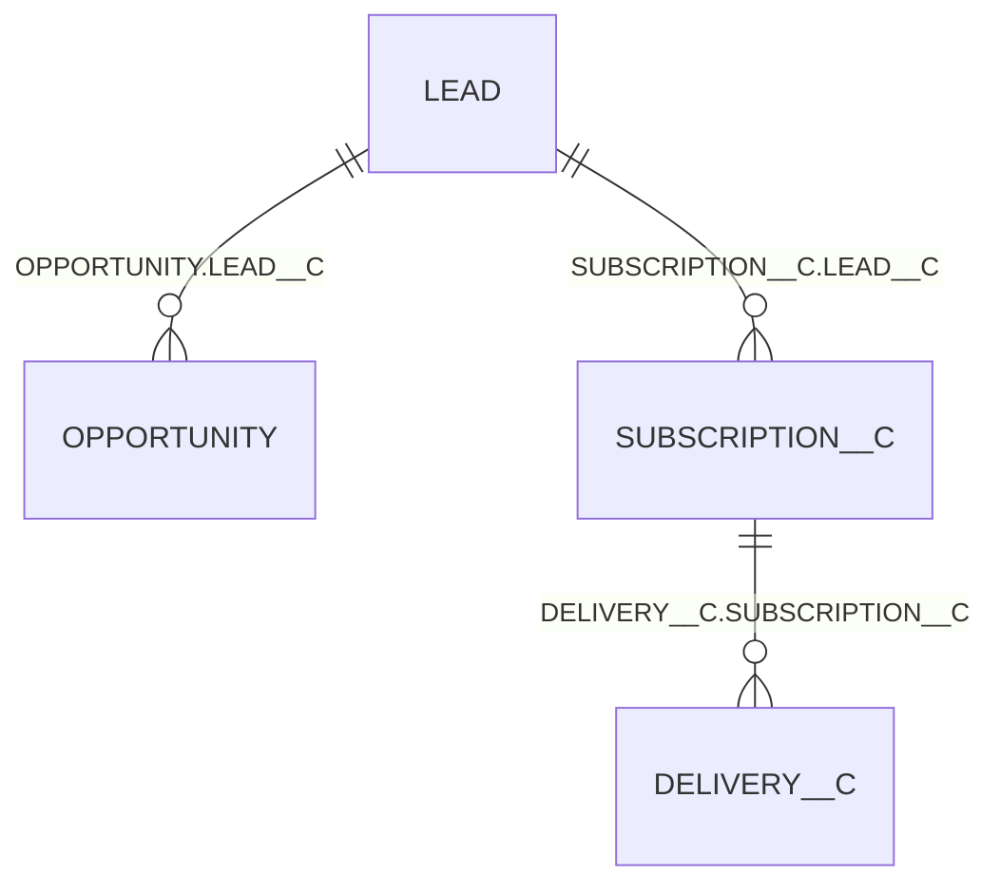

# Monthly Conversion Funnel: From Lead to First Delivery

This repository turns raw CRM data (leads, opportunities, subscriptions and deliveries) into a monthly conversion funnel. For the leads created in each month, it counts how many were qualified, converted, won as a deal, given an active subscription and sent a first delivery. It is built with dbt on DuckDB; the task is described in [ASSIGNMENT.md](ASSIGNMENT.md).

- **Management report:** [report/management-report.pdf](report/management-report.pdf)
- **Streamlit dashboard:** [http://localhost:8501](http://localhost:8501), after `make dashboard`

The funnel is counted as a **strict sequence**. On cleaned data it covers 3,238 leads in 18 monthly cohorts (2023-07 to 2024-12), of which 260 reach a first delivery.

## Where to find what

| The assignment asks for | Section |
| --- | --- |
| Which tables were used and why, and how the entities relate | [Tables and relationships](#tables-and-relationships) |
| How each funnel stage is defined | [Funnel stages](#funnel-stages) |
| How cross-stage inconsistencies are handled, and why | [Cross-stage inconsistencies](#cross-stage-inconsistencies) |
| Data quality problems found and how they were solved, with counts | [Data quality](#data-quality) |
| Operation: incremental updates, late-arriving data, reactivations, idempotency | [Operating the model](#operating-the-model) |
| Assumptions and trade-offs | [Assumptions and trade-offs](#assumptions-and-trade-offs) |
| The project's layers and why they are split this way | [Project structure](#project-structure) |
| The tests | [Tests](#tests) |

## Reporting model output

The deliverable is the reporting model `rep_conversion_funnel_monthly`, with one row per month and funnel step. March 2024, the example month in the assignment, is shown here; the dashboard linked above has every month.

| month      | kpi_name            | funnel_step | count | conversion_from_previous_pct |
|------------|---------------------|-------------|-------|------------------------------|
| 2024-03-01 | Lead Created        | 1           | 180   | NULL                         |
| 2024-03-01 | Lead Qualified      | 2           | 126   | 70.0                         |
| 2024-03-01 | Lead Converted      | 3           | 80    | 63.5                         |
| 2024-03-01 | Opportunity Won     | 4           | 46    | 57.5                         |
| 2024-03-01 | Subscription Active | 5           | 23    | 50.0                         |
| 2024-03-01 | First Delivery      | 6           | 23    | 100.0                        |

## Run it

Needs Python 3.12 and the provided database at `data/interview_assignment.duckdb`.

```bash
make build      # create the environment, build the models and run the tests
make dashboard  # start the Streamlit dashboard at http://localhost:8501
```

The dashboard's Management view, one of its three views (Management, Decisions, Reporting model):



## Project structure



| Layer | Responsibility | Why it is separate |
| --- | --- | --- |
| Staging | Cleans one source table: removes invalid rows, fixes types and values, renames columns. No joins. | Every data fix lives in one place and can be tested against the raw table. |
| Intermediate | Joins the cleaned tables to one row per lead and decides which funnel stages the lead reached. | The funnel rules sit in one model at lead level, where they can be inspected and tested lead by lead. |
| Reporting | Counts leads per cohort month and stage and computes the conversion rate. | Aggregation only, so the published table contains no business logic of its own. |

Staging and intermediate models are views, because they are cheap and always reflect the source. The reporting model is a table, because it is the one that gets queried. Each layer writes to its own schema (`main_staging`, `main_intermediate`, `main_reporting`).

The decisions made in each staging model are listed in the comment at the top of its SQL file.

## Tables and relationships

| Table | Used | Why |
| --- | --- | --- |
| `LEAD` | Yes | Defines the cohort (creation month) and stages 1 to 3. |
| `OPPORTUNITY` | Yes | Stage 4. |
| `SUBSCRIPTION__C` | Yes | Stage 5. |
| `DELIVERY__C` | Yes | Stage 6. |
| `ACCOUNT` | No | No stage is defined on it, and leads link to opportunities and subscriptions directly. It stays declared as a source. |

The relationships were derived from the data:

| Child column | Parent | Null keys | Unmatched keys | Cardinality |
| --- | --- | --- | --- | --- |
| `OPPORTUNITY.LEAD__C` | `LEAD.ID` | 0 | 0 | 5 leads have two opportunities |
| `SUBSCRIPTION__C.LEAD__C` | `LEAD.ID` | 1 | 7 | 4 leads have two subscriptions |
| `DELIVERY__C.SUBSCRIPTION__C` | `SUBSCRIPTION__C.ID` | 0 | 3 | up to 7 deliveries per subscription |



Two points follow from this:

- **A lead reaches its opportunity through `OPPORTUNITY.LEAD__C`, not `LEAD.CONVERTED_OPPORTUNITY_ID`.** The two paths never contradict each other, but `LEAD__C` is complete, while the converted ID is empty for 8 converted leads and misses 10 opportunities that no lead names. The choice changes the result: 548 leads have a won opportunity through `LEAD__C`, 540 through the converted ID.
- **Both lead relationships are one-to-many.** Opportunities and subscriptions are therefore reduced to one result per lead ("has at least one") before joining. A row-to-row join would count those leads twice.

## Funnel stages

All stages are evaluated per lead and counted in the month of `LEAD.CREATED_DATE`, regardless of when the opportunity, subscription or delivery happened.

| Step | Stage | Condition on the lead |
| --- | --- | --- |
| 1 | Lead Created | A valid lead: not deleted, not future-dated, one row per ID. |
| 2 | Lead Qualified | `STATUS = 'Qualified'`. |
| 3 | Lead Converted | `IS_CONVERTED = true`. |
| 4 | Opportunity Won | At least one non-deleted opportunity with stage `Closed Won`, after normalising case and whitespace. |
| 5 | Subscription Active | At least one non-deleted subscription with `STATUS__C = 'Active'`. |
| 6 | First Delivery | At least one non-deleted delivery on an active subscription of the lead. |

Under the strict sequence, a lead counts at step N only if it also meets the conditions of steps 1 to N-1.

## Cross-stage inconsistencies

13 of 3,238 leads (0.4%) meet the condition of a stage without meeting all earlier ones:

| Leads | What they have | What they lack |
| --- | --- | --- |
| 5 | A won opportunity | The converted flag (2 are also not Qualified) |
| 8 | An active subscription (1 also has a delivery) | Any opportunity and the converted flag (5 are also not Qualified) |

Stages 2 and 3 are consistent: every converted lead has the status Qualified.

### Chosen approach: strict sequence

`conversion_from_previous_pct` only means "of the leads that reached the previous stage, the share that reached this one" if each stage is a subset of the one before. The strict sequence guarantees that for any data, not only for today's.

### Impact on the metric

| | Independent count | Strict sequence (chosen) |
| --- | --- | --- |
| Monotonicity | Holds in every month of this data, but is not guaranteed | Guaranteed: counts never increase from one step to the next |
| Range of conversion | 7.1 to 100.0 in this data; can exceed 100 | Always 0 to 100 |
| Records filtered out | None | 13 leads lose 14 stage counts: 5 at step 4, 8 at step 5, 1 at step 6 |

Steps 1 to 3 are the same under both approaches. The later steps differ:

| Stage | Independent | Strict | Difference |
| --- | --- | --- | --- |
| 4 Opportunity Won | 548 | 543 | 5 |
| 5 Subscription Active | 268 | 260 | 8 |
| 6 First Delivery | 261 | 260 | 1 |

The two approaches differ in 4 of 18 months, by at most 2 leads per stage.

The cost of the strict sequence is that 5 won opportunities and 8 active subscriptions are real business that the funnel does not show. They are not lost: `int_lead_funnel_stages` keeps each stage's own condition next to the strict result and flags these leads with `is_stage_consistent = false`.

## Data quality

Counts are on the raw tables. The full findings are in [analyses/data-exploration-report.md](analyses/data-exploration-report.md).

### Issues that change the funnel

| Issue | Rows | Resolution |
| --- | --- | --- |
| Duplicated lead IDs. The copies differ only in `CREATED_DATE`, by minutes, within the same month. | 15 IDs (30 rows) | Earliest row kept, in `stg_leads`. `LAST_MODIFIED_DATE` is identical on both copies, so it cannot decide which to keep. |
| Soft-deleted rows. | 10 leads, 5 opportunities, 3 subscriptions, 4 deliveries | Removed in staging. Every deleted child belongs to a deleted lead. |
| Leads created in the future (2027 to 2099). | 5 | Removed in `stg_leads`. They would add five cohort months that do not exist. |
| `Closed Won` in case and whitespace variants. | 10 opportunities | Stage name normalised in `stg_opportunities`. An exact match would miss them. The text is corrected instead of using `IS_WON`, because the assignment defines the stage by `STAGE_NAME`; the two agree on every row after cleaning. |
| Leads flagged converted with no opportunity ID. | 8 | Counted as converted, because the stage is defined by the flag. They have no opportunity and stop at step 3. |

### Issues found that do not change the funnel

| Issue | Rows | Resolution |
| --- | --- | --- |
| Records without a valid parent: subscriptions without a lead, deliveries without a subscription. | 7 subscriptions unmatched and 1 empty; 3 deliveries | Kept in staging. They join to no lead and never reach the funnel. A `relationships` test reports them as a warning. |
| Dates stored as text (`CONVERTED_DATE`, `START_DATE__C`, `END_DATE__C`). | all rows | Cast to dates in staging. Every value parses. |
| Brand differs from the lead's brand. | 7 opportunities, 11 subscriptions | No fix. The funnel is counted per lead, so the lead's brand applies. |
| End date and cancellation reason do not follow the subscription status. | 72 active subscriptions with an end date, 70 cancelled without one | Neither field is used. |
| `ACCOUNT`: duplicated IDs, and references to accounts that do not exist. | 15 IDs; 9 opportunities, 13 subscriptions | Table not used. |
| Dates in an unexpected order: subscription start before record creation; opportunity stage change before creation. | 410 subscriptions; 19 opportunities | No fix. A start date agreed before the record was entered is plausible, and neither field is used in the funnel. |
| `SUBSTATUS__C = 'Duplicate'` on leads. | 648 | Not treated as duplicate records. These leads convert at the same rate as all others, so the value does not mark a duplicate. |

The cleaning is what makes March 2024 match the example in the assignment (see [Reporting model output](#reporting-model-output)). The raw table gives 196 leads created, 142 qualified and 96 converted for that month, instead of 180, 126 and 80.

## Tests

58 tests: 54 pass and 4 warn on purpose.

| Test | What it checks |
| --- | --- |
| `unique`, `not_null`, `relationships`, `accepted_values` | Keys and references on the raw tables, the staging models and the lead-level model. |
| `assert_funnel_counts_never_increase` | No step has more leads than the step before. This follows from the strict funnel. |
| The other funnel tests in `tests/` | The rate is between 0 and 100 and equals count / previous count; every month has six steps; step 1 equals the cleaned leads. |

The four warnings are known problems in the raw data: duplicated IDs in `LEAD` and `ACCOUNT` (15 each), and 7 subscriptions and 3 deliveries without a parent record.

## Operating the model

### Incremental updates

- **Today:** rebuilt in full on every run. It takes under a second and cannot drift.
- **In production:** incremental on `(month, funnel_step)` with `delete+insert`, recomputing only the cohorts whose leads, opportunities, subscriptions or deliveries changed since the last run. `merge` would give the same result, because a recomputed cohort replaces all six of its rows. A scheduled full refresh would correct any drift.

Recomputing only the newest month would be wrong, because a cohort keeps changing after its month ends: the first delivery arrives 35 to 83 days after the lead (median 43), and subscriptions were modified up to 465 days later.

### Late-arriving data

- **Today:** an opportunity, subscription or delivery that appears months after the lead is counted in the lead's original cohort, so published numbers for past months change. A lead that is loaded late also belongs to its original cohort.
- **In production:** the change-driven recompute covers late events. Detecting late-loaded leads needs a load timestamp, which the source does not have; `LAST_MODIFIED_DATE` is the closest substitute.

### Reactivations

- **Today:** stage 5 reads the current subscription status, so the funnel shows the current state, not "ever reached". A reactivated subscription brings its lead back into stage 5, in its original cohort. A cancelled one takes the lead out of stages 5 and 6, so counts for old cohorts can go down. A second subscription on the same lead does not count twice.
- **In production:** a dbt snapshot on the subscription table, to collect the status history that reporting "ever active" needs.

### Idempotency

- **Today:** two runs on the same data on the same day give identical output, because it is a full rebuild with no appends and de-duplication is deterministic. The output still depends on the run date in two ways: the future-date filter compares with it, and stages 2 and 5 read current statuses.
- **In production:** snapshots, so that yesterday's result can be reproduced after the source has changed.

## Assumptions and trade-offs

- Stage 6 is 100% of stage 5 in every month. In this data deliveries exist only on active subscriptions, and almost every active subscription has one. Under the assignment's definition ("a delivery for that subscription") the last step adds little information. A funnel on "ever had a delivery" would need status history.
- Delivery status is not filtered. Cancelled and returned deliveries count. Every subscription with a delivery has at least one with status Delivered, so a filter would not change the result.
- A missing patient account does not exclude a subscription. Six active subscriptions reference an account that does not exist. Requiring a valid account would not change the strict funnel: none of the affected leads reaches step 5 through it.
- Every cohort month has six rows, including a step with a count of 0. The rate is `NULL` when the previous step is 0, and is rounded to one decimal, following the example in the assignment.
- Timestamps are used as delivered, without time zone conversion. A shift of a few hours would move leads created near a month boundary into the neighbouring cohort.
- No dbt packages. The funnel tests are plain SQL files in `tests/` instead of `dbt_utils` macros, so the project runs without `dbt deps` or network access.
