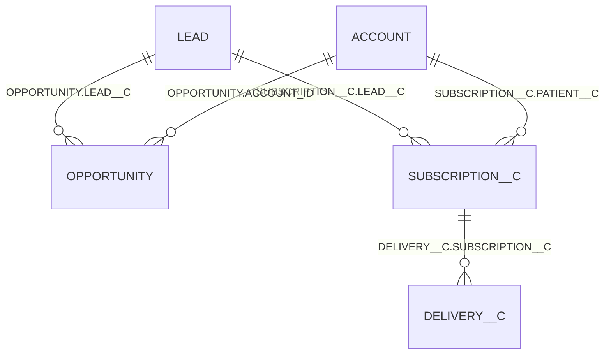

# Data exploration report

What the source data looks like, what is wrong with it, and the decisions that follow for the conversion funnel. Explored against `data/interview_assignment.duckdb`, schema `assignment`. The queries are in [data_exploration.sql](data_exploration.sql).

## Summary

The five source tables hold 3,268 leads, 994 opportunities, 563 subscriptions, 1,608 deliveries and 1,000 accounts. After cleaning, 3,238 leads remain in 18 monthly cohorts (2023-07 to 2024-12).

| Finding | Decision |
| --- | --- |
| 15 lead IDs appear twice | Keep the earliest row |
| 22 rows are soft-deleted | Remove them |
| 5 leads are dated in the future | Remove them |
| 10 opportunities have a misspelled `Closed Won` | Normalise the stage name |
| 8 subscriptions and 3 deliveries have no valid parent | Keep them; they never join to a lead |
| A lead reaches its opportunity by two paths | Use `OPPORTUNITY.LEAD__C` |
| The account table is unreliable and no stage needs it | Do not use it |
| 13 leads reach a stage without the earlier ones | Count the funnel as a strict sequence |

The cleaning reproduces the example row in the assignment exactly: March 2024 gives 180 leads created, 126 qualified (70.0%) and 80 converted (63.5%). The raw table gives 196, 142 and 96.

## 1. Source tables

| Table | Rows | Distinct IDs | Deleted rows |
| --- | --- | --- | --- |
| `LEAD` | 3,268 | 3,253 | 10 |
| `OPPORTUNITY` | 994 | 994 | 5 |
| `SUBSCRIPTION__C` | 563 | 563 | 3 |
| `DELIVERY__C` | 1,608 | 1,608 | 4 |
| `ACCOUNT` | 1,000 | 985 | 0 |

- No table has an empty `ID`.
- Three date columns are stored as text in `YYYY-MM-DD` form: `LEAD.CONVERTED_DATE`, `SUBSCRIPTION__C.START_DATE__C` and `SUBSCRIPTION__C.END_DATE__C`. Every value parses as a date.
- Timestamps carry no time zone.
- Columns that the assignment's glossary does not list: `LEAD.SUBSTATUS__C`, `LEAD.CONVERTED_DATE`, `LEAD.FIRST_NAME`, `LEAD.LAST_NAME`, `OPPORTUNITY.LAST_MODIFIED_DATE`, `SUBSCRIPTION__C.PATIENT__C`, `SUBSCRIPTION__C.APPROVAL__C`, `SUBSCRIPTION__C.DELIVERY_CYCLE__C`, and `OWNER_ID` on every table except `DELIVERY__C`.

## 2. Data quality issues

Counts are on the raw tables.

| # | Issue | Count | Detail | Resolution |
| --- | --- | --- | --- | --- |
| 1 | Duplicated lead IDs | 15 IDs (30 rows) | The two copies differ only in `CREATED_DATE`, by a few minutes, within the same month. `LAST_MODIFIED_DATE` is identical. | Keep the earliest row. |
| 2 | Soft-deleted rows | 10 leads, 5 opportunities, 3 subscriptions, 4 deliveries | Every deleted child belongs to a deleted lead. No live row points at a deleted parent. | Remove in staging. |
| 3 | Future-dated leads | 5 | `CREATED_DATE` between 2027 and 2099. None has an opportunity or subscription. | Remove. They would add five cohort months that do not exist. |
| 4 | Misspelled `Closed Won` | 10 opportunities | Case and whitespace variants such as `closed won`, ` Closed Won`, `Closed  Won`. All have `IS_WON = true`. | Normalise the stage name. An exact match would miss them. |
| 5 | Subscriptions without a valid lead | 7 unmatched, 1 empty | `LEAD__C` names a lead that does not exist, or is empty. | Keep. They join to no lead. Reported by a test as a warning. |
| 6 | Deliveries without a valid subscription | 3 | `SUBSCRIPTION__C` names a subscription that does not exist. | Keep, same reasoning. |
| 7 | Converted leads without an opportunity ID | 8 | `IS_CONVERTED = true` but `CONVERTED_OPPORTUNITY_ID` is empty; 2 also lack an account ID. None has an opportunity or subscription. | Count as converted. The stage is defined by the flag. |
| 8 | Converted leads naming a missing opportunity | 4 | 2 are future-dated leads and 2 are deleted leads. | No action. Both groups are removed anyway. |
| 9 | Brand differs from the lead's brand | 7 opportunities, 11 subscriptions | Deliveries always match their subscription's brand. | No fix. The funnel is counted per lead, so the lead's brand applies. |
| 10 | Duplicated account IDs | 15 IDs (30 rows) | The copies differ only in `CREATED_DATE`. | Table not used. |
| 11 | References to accounts that do not exist | 9 leads, 9 opportunities, 13 subscriptions | | Table not used. |
| 12 | End date and cancellation reason do not follow the subscription status | 72 active subscriptions with an end date, 70 cancelled without one | 115 active subscriptions also carry a cancellation reason. | Neither field is used. |
| 13 | Dates in an unexpected order | 410 subscriptions, 19 opportunities | Subscription start before record creation; opportunity stage change before creation. | No fix. Plausible, and not used in the funnel. |

Checks that found nothing: no subscription ends before it starts, and no opportunity, subscription or delivery is dated before its parent.

## 3. Column values

| Column | Values (rows) |
| --- | --- |
| `LEAD.STATUS` | Qualified 1,954, New 591, Unqualified 362, Lost 361 |
| `LEAD.SUBSTATUS__C` | empty 1,307, Complete 657, Standard 655, Duplicate 648, Spam 1 |
| `LEAD.LEAD_SOURCE` | Webseite 1,804, deinePflege 894, Partner 570 |
| `LEAD.BRAND__C` | Prosenio 1,021, Sanubi 1,021, PflegeBox 1,019, SanBox 207 |
| `OPPORTUNITY.STAGE_NAME` | Closed Won 544 (plus 10 variants), Closed Lost 149, Wird Unterschrieben 111, Ist Beantragt 80, zu beraten 68, Zu Korrigieren 32 |
| `SUBSCRIPTION__C.STATUS__C` | Active 280, Cancelled 97, Waiting for Approval 52, Draft 48, On-Hold 43, Completed 43 |
| `SUBSCRIPTION__C.CANCELLATION_REASON__C` | empty 321, Patient verstorben 83, Nicht mehr pflegebedürftig 81, Wechsel zu anderem Anbieter 56, Produktlinie eingestellt 13, Sortiment nicht mehr verfügbar 9 |
| `DELIVERY__C.STATUS__C` | Delivered 1,456, Cancelled 79, Returned 73 |

- Only `STAGE_NAME` has spelling or whitespace variants.
- `SUBSTATUS__C = 'Duplicate'` does not mark duplicate records. 205 of those 648 leads are converted, the same share as the other substatuses.
- The SanBox brand appears only in September and October 2024.

## 4. Consistency checks

**Flags against statuses**

- **Lead.** Every converted lead has `STATUS = 'Qualified'`. 943 Qualified rows are not converted. Stage 3 is therefore always contained in stage 2.
- **Opportunity.** After normalising the stage name, `IS_WON` and `IS_CLOSED` agree with it on every row (554 won, 149 lost).
- **Subscription.** End date and cancellation reason do not follow the status (issue 12).

**Deliveries**

- Every delivery with a valid subscription belongs to an Active subscription. No subscription in another status has a delivery.
- 269 of 277 live Active subscriptions have at least one delivery, and each of those has at least one with status Delivered. Filtering on delivery status would therefore not change stage 6.
- 104 deliveries dated November 2024 are extra deliveries on subscriptions that mostly have ordinary ones too. They do not affect the funnel, which only asks whether a delivery exists.

**Dates**

- Lead creation runs from 2023-07 to 2024-12. Deliveries run to 2025-07.
- Lead rows per month range from 60 (2023-12) to 482 (2024-09).
- The first delivery arrives 35 to 83 days after lead creation (median 43).
- Subscriptions were still being modified up to 465 days after their lead was created.

## 5. Relationships

| Child column | Parent | Child rows | Empty keys | Unmatched keys | Used for |
| --- | --- | --- | --- | --- | --- |
| `OPPORTUNITY.LEAD__C` | `LEAD.ID` | 994 | 0 | 0 | Stage 4 |
| `SUBSCRIPTION__C.LEAD__C` | `LEAD.ID` | 563 | 1 | 7 | Stage 5 |
| `DELIVERY__C.SUBSCRIPTION__C` | `SUBSCRIPTION__C.ID` | 1,608 | 0 | 3 | Stage 6 |
| `LEAD.CONVERTED_OPPORTUNITY_ID` | `OPPORTUNITY.ID` | 3,253 leads | 2,265 | 4 | Not used |
| `LEAD.CONVERTED_ACCOUNT_ID` | `ACCOUNT.ID` | 3,253 leads | 2,259 | 9 | Not used |
| `OPPORTUNITY.ACCOUNT_ID` | `ACCOUNT.ID` | 994 | 0 | 9 | Not used |
| `SUBSCRIPTION__C.PATIENT__C` | `ACCOUNT.ID` | 563 | 0 | 13 | Not used |

### Cardinality

Per live, de-duplicated lead (3,243 leads, before the future-dated ones are removed), counting live children only:

| Children per lead | Opportunities | Subscriptions |
| --- | --- | --- |
| 0 | 2,259 leads | 2,695 leads |
| 1 | 979 leads | 544 leads |
| 2 | 5 leads | 4 leads |

- Both lead relationships are one-to-many. Children are therefore reduced to one result per lead ("has at least one") before joining; a row-to-row join would count the leads with two children twice.
- On the 5 leads with two opportunities, the second one is always a misspelled `Closed Won`.
- On the 4 leads with two subscriptions, both are Active.
- Deliveries per live subscription (560): 291 have none, 4 have one, 25 have four or five, 240 have six or seven.

### Two paths from a lead to its opportunity

A lead can reach an opportunity through `LEAD.CONVERTED_OPPORTUNITY_ID` or through `OPPORTUNITY.LEAD__C`.

| Converted ID on the lead | Opportunities via `LEAD__C` | Converted flag | Leads |
| --- | --- | --- | --- |
| Filled and valid | 1 | true | 974 |
| Filled and valid | 2 | true | 5 |
| Filled, matches no opportunity | 0 | true | 2 |
| Empty | 1 | false | 5 |
| Empty | 0 | false | 2,249 |
| Empty | 0 | true | 8 |

- The paths never contradict each other. Wherever the converted ID is valid, that opportunity is also found through `LEAD__C`.
- `LEAD__C` finds 10 more opportunities that no lead names in its converted ID. Five are second opportunities on converted leads; five sit on leads that are not flagged converted.
- Leads with a won opportunity: 540 through the converted ID, 548 through `LEAD__C`.

**Decision: stage 4 uses `OPPORTUNITY.LEAD__C`.** It has no empty and no unmatched keys, it finds every opportunity the other path finds plus ten more, and it matches the assignment's wording ("the lead has a linked opportunity").

### Account table

**Decision: `ACCOUNT` is not used.** No stage is defined on it, and leads link to opportunities and subscriptions directly. It also has duplicated IDs and is referenced by IDs that do not exist (issues 10 and 11). It stays declared as a source.

A subscription does not need a valid patient account to count. Six Active subscriptions reference an account that does not exist. Requiring a valid account would not change the strict funnel (stage 5 stays at 260 leads). Under an independent count it would lower stage 5 from 268 to 264 and stage 6 from 261 to 260.

## 6. Funnel semantics

Measured on cleaned data: 3,238 leads.

### Cross-stage inconsistencies

13 leads (0.4%) meet the condition of a stage without meeting all earlier ones.

| Stage reached | Stage missing | Leads | What they are |
| --- | --- | --- | --- |
| 3 Converted | 2 Qualified | 0 | Every converted lead is Qualified. |
| 4 Opportunity Won | 3 Converted | 5 | Won opportunities on leads not flagged converted; 2 of the leads are also not Qualified. |
| 5 Subscription Active | 4 Opportunity Won | 8 | Active subscriptions on leads with no opportunity; none is converted, 5 are not Qualified. One of them also has a delivery. |
| 6 First Delivery | 5 Subscription Active | 0 | |

### Independent count against strict sequence

| Stage | Independent | Strict | Difference |
| --- | --- | --- | --- |
| 1 Lead Created | 3,238 | 3,238 | 0 |
| 2 Lead Qualified | 1,929 | 1,929 | 0 |
| 3 Lead Converted | 987 | 987 | 0 |
| 4 Opportunity Won | 548 | 543 | 5 |
| 5 Subscription Active | 268 | 260 | 8 |
| 6 First Delivery | 261 | 260 | 1 |

| Impact | Independent | Strict |
| --- | --- | --- |
| Monotonicity | Holds in every month of this data, but is not guaranteed | Guaranteed |
| Range of `conversion_from_previous_pct` | 7.1 to 100.0 in this data; can exceed 100 | Always 0 to 100 |
| Records filtered out | None | 13 leads lose 14 stage counts (5 + 8 + 1) |

The two approaches differ in 4 of 18 months, all in 2023, by at most 2 leads per stage.

**Decision: strict sequence.** `conversion_from_previous_pct` only means "of the leads that reached the previous stage, the share that reached this one" if each stage is a subset of the one before. The strict sequence guarantees that for any data and gives a simple rule to test. The cost is 13 leads, 0.4% of the total.

The argument for the independent count is that the 5 won opportunities and 8 active subscriptions are real business that the strict funnel does not show. The lead-level model keeps both views and flags these leads.

### Strict funnel by cohort

| Month | Created | Qualified | Converted | Won | Active | Delivery |
| --- | --- | --- | --- | --- | --- | --- |
| 2023-07 | 140 | 110 | 65 | 41 | 20 | 20 |
| 2023-08 | 150 | 99 | 50 | 31 | 17 | 17 |
| 2023-09 | 160 | 121 | 64 | 35 | 21 | 21 |
| 2023-10 | 170 | 110 | 65 | 30 | 16 | 16 |
| 2023-11 | 155 | 119 | 75 | 33 | 14 | 14 |
| 2023-12 | 60 | 36 | 19 | 11 | 3 | 3 |
| 2024-01 | 80 | 50 | 27 | 13 | 9 | 9 |
| 2024-02 | 160 | 124 | 67 | 37 | 21 | 21 |
| 2024-03 | 180 | 126 | 80 | 46 | 23 | 23 |
| 2024-04 | 176 | 116 | 63 | 32 | 22 | 22 |
| 2024-05 | 186 | 126 | 66 | 41 | 19 | 19 |
| 2024-06 | 181 | 125 | 63 | 35 | 7 | 7 |
| 2024-07 | 176 | 141 | 77 | 42 | 3 | 3 |
| 2024-08 | 171 | 112 | 70 | 40 | 24 | 24 |
| 2024-09 | 481 | 142 | 21 | 13 | 9 | 9 |
| 2024-10 | 351 | 100 | 25 | 13 | 7 | 7 |
| 2024-11 | 191 | 132 | 70 | 42 | 20 | 20 |
| 2024-12 | 70 | 40 | 20 | 8 | 5 | 5 |

Stage 6 equals stage 5 in every month: every lead that passed stages 1 to 5 has a delivery.

## 7. Definitions used

| Step | Stage | Definition | Note |
| --- | --- | --- | --- |
| 1 | Lead Created | A valid lead, counted in the month of `CREATED_DATE` | Not deleted, not future-dated, one row per ID. |
| 2 | Lead Qualified | `STATUS = 'Qualified'` | Current status. |
| 3 | Lead Converted | `IS_CONVERTED = true` | Includes the 8 converted leads without an opportunity ID. |
| 4 | Opportunity Won | At least one live opportunity via `OPPORTUNITY.LEAD__C` with stage `Closed Won` after normalising | One won opportunity is enough. |
| 5 | Subscription Active | At least one live subscription with `STATUS__C = 'Active'` | Current status; the data has no status history. 280 leads have a subscription but none Active. |
| 6 | First Delivery | At least one live delivery on an Active subscription of the lead | Delivery status is not filtered. |

Under the strict sequence, a lead counts at step N only if it also meets steps 1 to N-1.

| Output rule | Choice |
| --- | --- |
| Rows per month | Always six, including a step with a count of 0 |
| Previous step is 0 | `conversion_from_previous_pct` is `NULL` |
| Rounding | One decimal, as in the assignment's example |
| Months included | Every month with at least one valid lead |
| Recent cohorts | Included, although they have had less time to convert |
